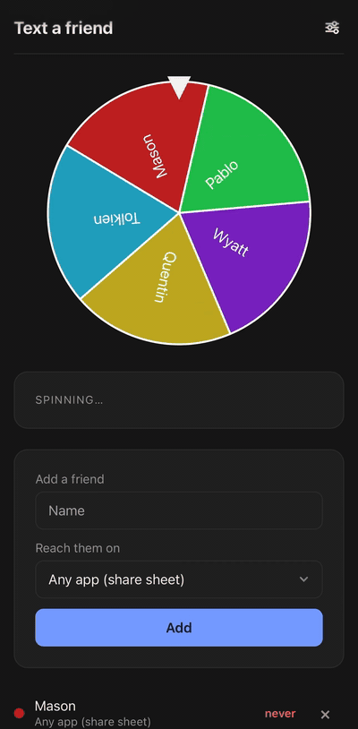

<div align="center">
  
  <h1>Text a friend</h1>
  <p><strong>A roulette wheel that picks the friend you've been neglecting and writes your opening line.</strong></p>
  <p>
    
    
    
    
    
  </p>
  <p>
    <a href="https://text-a-friend.vercel.app/">Live demo</a> ·
    <a href="#how-it-works">How it works</a> ·
    <a href="#features">Features</a> ·
    <a href="#under-the-hood">Under the hood</a> ·
    <a href="#run-it-locally">Run it</a>
  </p>
</div>

Every Monday a roulette wheel picks the friend you've gone longest without talking to and hands you a ready-to-send opening line. One tap opens Messages, WhatsApp or email with the line already typed, or the share sheet for anything else. Mark it done to grow your weekly streak. No account, no server, nothing leaves your phone.

<p align="center"></p>

## Live

**→ [text-a-friend.vercel.app](https://text-a-friend.vercel.app/)** · Open it in Safari, tap Share, then Add to Home Screen.

## Why

Keeping up with friends is the thing everyone means to do and nobody schedules. Loneliness is the problem a whole generation names first, and the fix is embarrassingly small: one text, to one person, once a week. This app removes the two decisions that stop that text from happening, _who_ and _what to say_, and makes the whole thing take ten seconds.

## How it works

1. **Add a few friends** with how you reach them: phone, WhatsApp, Instagram, email, or just the share sheet.
2. **Every Monday the wheel spins.** It's rigged: whoever you've neglected longest wins, ties are random.
3. **Send the line** it wrote, then tap _I reached out_. Your streak grows and a countdown runs to the next spin.

## Features

|                                    |                                                                                                                                                                      |
| ---------------------------------- | -------------------------------------------------------------------------------------------------------------------------------------------------------------------- |
| 🎡 **Rigged roulette**             | Inline SVG wheel, one slice per friend, lands on the least-recently-contacted. Spins only when you ask it to.                                                        |
| 💬 **Lines you can actually send** | First-person openers with the name filled in. Reroll if one doesn't sound like you.                                                                                  |
| 🔗 **Real deep links**             | SMS, WhatsApp and email open with the text already typed. Instagram opens the profile and copies the line for you. A country picker builds the international number. |
| 🔥 **Streaks and a countdown**     | Consecutive weeks reached out, and a live timer to Monday 00:00 after you've done this week's text.                                                                  |
| 🟢🟠🔴 **The list nags**           | Last-contact turns green, amber, red. Removing a friend you've texted asks first.                                                                                    |
| 🧾 **Backup code**                 | Your whole list squashed into one opaque line, about 230 characters for ten friends. Paste it on any device to restore. No file, no login.                           |
| 📅 **Monday reminder**             | Downloads a repeating calendar event. Reminders without notification permission or a server.                                                                         |
| 🔴 **Icon badge**                  | Installed to a home screen, the icon shows a dot until this week's text is sent.                                                                                     |
| 🖼️ **Your year in texts**          | A shareable stats card drawn on a canvas, switched on for the last weeks of the year.                                                                                |
| ♿ **Accessible by default**       | Labels on every input, native `<dialog>`, 44px targets, visible focus, reduced-motion respected.                                                                     |

## Under the hood

|                      |                                                                                |
| -------------------- | ------------------------------------------------------------------------------ |
| Framework            | [Preact](https://preactjs.com) + [Vite](https://vite.dev) + TypeScript, strict |
| Runtime dependencies | **1** (`preact`, 7 KB). Everything else is the platform.                       |
| JavaScript shipped   | **15 KB gzipped**                                                              |
| Styles               | 1.8 KB of plain CSS, system fonts, `light-dark()` for themes                   |
| State                | `useState` + `localStorage`, validated on every read                           |
| Routing              | A ten-line hook that watches the URL hash                                      |
| Tests                | **46**, all on pure functions in `src/lib`, run by Vitest                      |
| Backend              | None. Static files on a CDN.                                                   |

A few bits worth reading:

- **The wheel** ([`lib/wheel.ts`](src/lib/wheel.ts)) is geometry, not a library: slice paths from angles, a `landing()` function that adds four full turns and stops on the winner, golden-angle hues so neighbouring slices never clash. The spin is one CSS transition. The pivot needs `transform-box: fill-box`, because a viewBox with a negative origin sends `transform-origin: 50% 50%` to the wrong corner.
- **The backup code** ([`lib/code.ts`](src/lib/code.ts)) is compact JSON → the browser's built-in deflate → base64url. Restoring reverses it and runs the result through the same validator that guards `localStorage`, so a tampered code drops bad rows instead of trusting them.
- **The Monday reminder** ([`lib/ics.ts`](src/lib/ics.ts)) hand-writes a VCALENDAR with `RRULE:FREQ=WEEKLY;BYDAY=MO`, which every phone calendar imports as a repeating event.
- **Deep links** ([`lib/methods.ts`](src/lib/methods.ts)) use the one SMS separator both iOS and Android accept, `?&body=`, and `wa.me` for WhatsApp with the number normalised to E.164.

## Privacy

There is no server, no account and no analytics. Names and contact handles live in this browser's local storage and never leave the device. Private browsing wipes them when the window closes, and Safari deletes site data after seven days without a visit unless the page is on the home screen, so install it, or keep a backup code.

## Run it locally

```bash
npm install
npm run dev      # http://localhost:5173
npm test         # 46 tests
npm run build    # prints the bundle size
```

## Project structure

```
src/
  app.tsx            root: state, actions, the two pages
  app.css            all styles
  components/        Wheel, PickCard, AddFriend, FriendList, YearCard, Nav, SettingsPage
  hooks/             useNow, useHash, useBadge, useOverride
  lib/               pure logic with tests: state, wheel, methods, countries, code, stats, ics, flags
public/              manifest and icons
```

## Roadmap

- [ ] Drag to spin
- [ ] Snooze a friend for a few weeks
- [ ] Birthdays rig the wheel
- [ ] Your own inside-joke lines per friend

---

<div align="center">
  <sub>Built as a small, finished thing. One screen, one job, loads instantly, installs on a phone.</sub>
</div>
